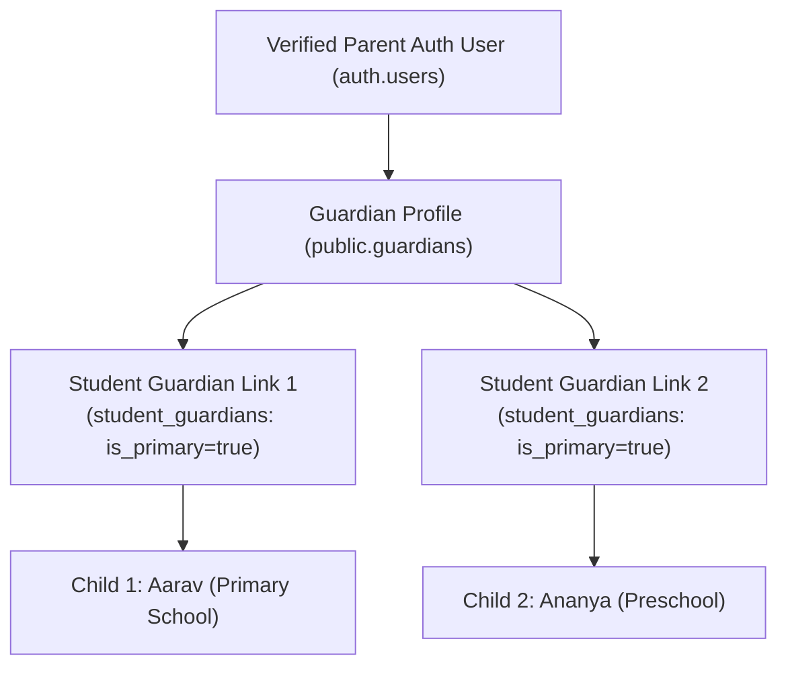

# AUVRYN — Parent & Guardian Verification Framework

**Technical Specification & Policy Guide**  
**Module**: Guardian Verification, Multi-Child Architecture & Account Linking  
**Compliance**: DPDP Act, 2023, Section 9 (Processing of Personal Data of Children)  
**Status**: Production-Ready  

---

## 1. Scope & Core Directives

In educational environments, parental access is critical for academic oversight, fee settlements, attendance monitoring, and health emergencies. However, improper parental binding creates severe privacy hazards.

AUVRYN enforces a strict legal standard:
> **Core Security Principle**: Physical possession or entry of a phone number or email address during admission does NOT constitute proof of lawful guardianship.

Every parent or guardian account must pass formal relationship verification and institution validation before gaining portal access to a child's academic and personal records.

---

## 2. Guardian Verification Lifecycle

```
[Unverified / Draft] ──> [Submitted] ──> [Under Verification] ──> [Verified]
                                                 │                      │
                                                 ▼                      ▼
                                            [Rejected]             [Suspended]
```

| State | Definition | Permissions |
| :--- | :--- | :--- |
| `submitted` | Contact entered in admission registration; OTP verification completed. | Read-only access to admission application status. Cannot view full student records. |
| `pending` / `under_verification` | Admission approved; verification of relationship declaration pending staff review. | Access to onboarding dashboard only. |
| `verified` | Admissions officer or administrator has reviewed proof of guardianship and certified the record. | Full parent portal access: academic grades, attendance, fees, announcements, emergency contacts. |
| `rejected` | Relationship declaration refuted, conflicting custody documentation, or invalid identification. | Portal access revoked; student records immediately disconnected from user profile. |
| `suspended` | Administrative lock due to court orders, custody disputes, or fee delinquency flags. | Access held in abeyance pending legal resolution. |

---

## 3. Multi-Child Linking Architecture

A major UX requirement for families with multiple children in the same institution or across educational tiers (e.g., one child in Preschool and another in Intermediate) is seamless multi-child management without redundant credentials.



### Relational Schema Design:
1. **`public.guardians`**: Represents the individual parent/guardian entity scoped to an institution. Stores verified email, verified mobile number, occupation, and link to `auth.users(id)`.
2. **`public.student_guardians`**: An explicit join table mapping `guardian_id` to `student_id`.
   - Attributes: `relationship` (`father`, `mother`, `legal_guardian`, `grandparent`), `is_primary`, `is_emergency_contact`, and `can_pickup`.
   - Prevents duplicate guardian records when enrolling siblings.
   - Preserves independent relationship semantics (e.g., Parent 1 may be `primary` for Child 1, while Parent 2 is `primary` for Child 2).

---

## 4. Verification Methods

### 4.1 Mobile OTP Verification
- Upon entering the primary mobile number, an authenticated 6-digit cryptographic OTP is dispatched via SMS/WhatsApp.
- Validates that the applicant controls the communication endpoint.
- Sets `guardians.phone_verified = true` with an immutable verification timestamp.

### 4.2 Email Magic Link Verification
- Verification email dispatched containing an ephemeral token (15-minute expiration).
- Sets `guardians.email_verified = true`.

### 4.3 Relationship Declaration & Identity Verification
- For parents: Declaration under penalty of false representation.
- For court-appointed legal guardians: Mandatory upload of a **Legal Guardianship Order** or **Adoption Deed** issued by a competent civil court or juvenile justice authority.
- Stored as an identity document with type `other` / `national_id` in the private bucket `student-documents`.

---

## 5. Emergency Contact vs. Legal Guardianship

AUVRYN maintains a strict distinction between an **Authorized Emergency Contact / Pickup Person** and a **Lawful Guardian**:

| Feature | Legal Guardian (`guardians`) | Emergency Contact (`student_emergency_contacts`) |
| :--- | :--- | :--- |
| **Legal Basis** | Custodial parent or court-appointed legal guardian. | Designee nominated by the guardian for crisis contact or campus pickup. |
| **Portal Access** | Yes (upon verification). Can view grades, invoices, attendance. | **No portal access**. Not an authenticated user. |
| **Data Modifications**| Can update permitted contact details and request record corrections. | None. Contact details are updated only by lawful guardians or school admins. |
| **Consent Rights** | Has legal authority to grant or withdraw DPDP consents. | Cannot grant or withdraw consents. |
| **Campus Pickups** | Full authorization unless restricted by court order. | Permitted only if `is_authorized_pickup = true` with verified photo ID. |

---

## 6. Parent Portal Update & Record Correction Protocol

To ensure institutional data integrity, parents **cannot directly mutate academic records** (grades, marks, enrollments, legal name, date of birth, admission numbers).

### Permitted Self-Service Modifications (Instant):
- Secondary contact phone number
- Preferred communication language
- Preferred messaging channel (WhatsApp, SMS, Email)
- Emergency contact priority or alternate phone numbers

### Restricted Modifications (Request Correction Flow):
For changes to **Student Legal Name**, **Date of Birth**, **Gender**, or **Custodial Guardianship**:
1. Parent navigates to **Parent Portal -> Identity & Consents -> Request Correction**.
2. Parent submits the requested correction along with documentary justification (e.g. Gazette notification or amended Birth Certificate).
3. The request is routed to the institution's **Admissions & Records Office**.
4. Upon administrative review and verification against official records, the administrator executes the update.
5. An audit log entry is preserved in `public.audit_logs`.
