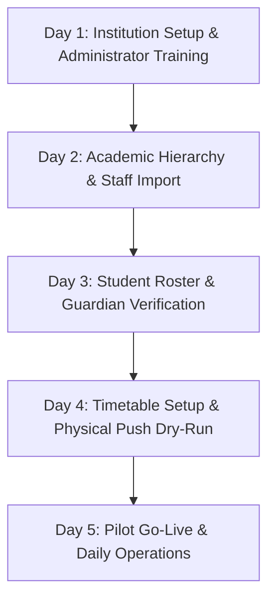

# AUVRYN — Educational Institution Pilot Onboarding Guide

**Audience**: Institutional Leadership, School IT Administrators, and AUVRYN Deployment Engineers  
**Target**: First Controlled School Pilot  

---

## 1. Pilot Mission Overview

The AUVRYN Pilot Program allows a single institution to operate their daily academic, attendance, fee, communication, and transport workflows on AUVRYN in an isolated, secure staging environment before full commercial roll-out.

---

## 2. Onboarding Timeline (5-Day Fast Track)

### Day 1: Institution Setup & Administrator Training
- Institutional Administrator account created via `/onboarding`.
- Institution settings configured:
  - Official school name, logo, legal registration, and contact information.
  - Education tier selected (Preschool, Primary, Intermediate, or University).
  - Campuses and academic terms defined.
- Initial security orientation: Zero-trust architecture, role boundaries, and audit logging.

### Day 2: Academic Hierarchy & Staff Import
- Academic programs, classes, and sections established in `/dashboard/timetable/classes`.
- Staff profiles imported or invited via `/dashboard/staff/invitations`:
  - Faculty assignments to departments.
  - Designation tags (`faculty`, `staff`, `accountant`, `transport_manager`).
- Faculty members complete initial password setup and login to `/portal/teacher`.

### Day 3: Student Roster & Guardian Verification
- Admissions office registers enrolled students via `/dashboard/admissions/new` or bulk roster import.
- Guardian contact details verified (phone numbers and relationship types).
- Voluntary identity document verification and masking completed.
- Guardians receive invitation SMS/email with download link for parent portal.

### Day 4: Timetable Setup & Push Notification Dry-Run
- Timetable periods, rooms, and weekly schedules published.
- **Physical Device Push Verification Gate**:
  - School Administrator and 2 designated faculty members install the Android pilot APK.
  - Confirm push token registration in `push_device_tokens`.
  - Issue test circular: *"Pilot Push Verification Notice"*.
  - Confirm visual notification banner appears on physical handset screens with high importance.

### Day 5: Pilot Go-Live & Daily Operations
- Morning attendance roll call conducted via `/portal/teacher`.
- Parents observe real-time attendance status in `/portal/parent`.
- Afternoon coursework assignments distributed and graded.
- End-of-day daily care summary (preschool) or homework digest delivered to parents.

---

## 3. Data Privacy & Aadhaar Compliance Briefing

1. **Voluntary Submission**: Providing Aadhaar numbers is strictly optional. Guardians may choose to omit identity document numbers without affecting enrollment status.
2. **Masked Storage**: Raw 12-digit Aadhaar numbers are **never stored** on AUVRYN servers or databases. Only the masked string (`•••• •••• 1234`) and a secure one-way cryptographic SHA-256 hash are kept.
3. **Role-Gated Access**: Identity documents and emergency contacts are restricted to verified admissions officers and legal guardians of the child.

---

## 4. Incident Response & Support Contacts

During the pilot phase, immediate support is available:
- **Deployment Engineer**: DevOps Lead (`devops@auvryn.edu`)
- **Database Administrator**: Cloud Infrastructure Team (`dba@auvryn.edu`)
- **Emergency Hotline**: Institutional Pilot Support Desk (24/7 during school hours)

### Escalation Protocol:
1. **P1 (System Down / Data Isolation Violation)**: Immediate freeze, database snapshot, and executive alert within 15 minutes.
2. **P2 (Feature Degraded / Notification Delay)**: Investigation and patch within 2 hours.
3. **P3 (Cosmetic / Minor UI Bug)**: Logged and scheduled for next routine build cycle.
