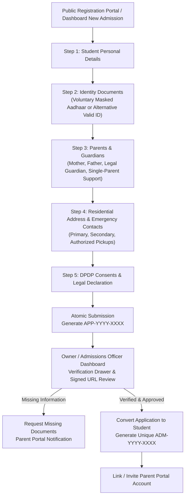

# AUVRYN — Student Registration & Admission Workflow

**Specification & Operating Manual**  
**Module**: Student Identity, Aadhaar & Parent/Guardian Registration  
**Compliance**: Digital Personal Data Protection (DPDP) Act, 2023 & UIDAI Circulars  
**Status**: Production-Ready  

---

## 1. Executive Summary

The **AUVRYN Student Registration & Admission Ecosystem** provides an end-to-end, multi-step digital admission experience designed for all institutional education tiers:
- **Preschool / Early Childhood** (Playgroup, Pre-K, LKG, UKG)
- **Primary School** (Grades 1–5)
- **Intermediate / Middle & High School** (Grades 6–10, +1, +2 / PUC)
- **University / Higher Education** (Undergraduate, Postgraduate, Doctoral)

The workflow operates seamlessly across the **Next.js Web Application** and the **Expo Mobile Application**, sharing identical validation schemas, server-side authorization policies, private cloud storage buckets, and PostgreSQL Row-Level Security (RLS) enforcement.

---

## 2. Architecture & Design Principles



### Core Principles:
1. **Voluntary Identity Provisioning**: Aadhaar is **never mandatory**. Parents/applicants can freely choose between submitting a masked Aadhaar reference or an alternative officially valid identity document (Birth Certificate, Passport, School Leaving Certificate, Transfer Certificate, etc.).
2. **Prohibition of Raw 12-Digit Aadhaar Numbers**: The application, API, and database reject any unmasked 12-digit numeric strings. Only masked formats displaying at most the last 4 digits (e.g., `XXXX-XXXX-1234` or `1234`) are accepted and stored.
3. **No Biometric Collection**: Fingerprint, iris, or facial biometrics are strictly prohibited from being collected, processed, or stored.
4. **Unbundled DPDP Consents**: Essential registration terms and privacy notice acknowledgements are strictly decoupled from optional consents (e.g., promotional photo/media publication and non-essential marketing communications).
5. **Private Storage Isolation**: Identity documents are uploaded exclusively to the private Supabase storage bucket `student-documents` and accessed exclusively via short-lived, signed cryptographic URLs (1-hour expiry).

---

## 3. The 5-Step Registration Wizard

### Step 1: Student Details & Academic Placement
- **Required Fields**:
  - Full Legal Name (`firstName`, `middleName`, `lastName`)
  - Date of Birth (`dateOfBirth` in `YYYY-MM-DD` format)
  - Gender (`male`, `female`, `other`, `prefer_not_to_say`)
  - Education Type (`preschool`, `primary_school`, `intermediate`, `university`)
  - Target Academic Year (`academicYearId`)
  - Target Academic Program / Course (`programId`)
  - Target Class / Grade (`classId`)
  - Admission Category (`general`, `merit`, `management`, `sports`, `sibling`, `staff_ward`, `ews_rte`, `international`, `other`)
  - Residential Address (Street, City, State, PIN/Postal Code, Country)
  - Nationality (defaults to `Indian`)
- **Optional Demographics**:
  - Preferred / Nickname (`preferredName`)
  - Mother Tongue, Second Language, Religion, Caste Category
  - Place of Birth (City, State, Country)
  - Visible Identification Marks (Mark 1, Mark 2)
  - Previous Educational Background (Previous School Name, Previous Grade/Score)
  - Transportation Requirements (Opt-in, Pickup Stop, Drop Stop)
  - Hostel / Boarding Requirements (Opt-in, Room Preference)
  - Sibling Information (Name, Admission Number, Class)
  - Emergency Medical Information (Allergies, Chronic Conditions, Dietary Restrictions, Blood Group Confirmed, Emergency Hospital, Family Doctor Details)
  - Special Educational Needs (Details, Requested Accommodations)

---

### Step 2: Identity Documents & Aadhaar Opt-in
- **Voluntary Aadhaar Selection**:
  - Users toggle: *"Does the applicant have an Aadhaar number to provide voluntarily?"* (Yes / No).
  - When **Yes**: Requires a **Masked Aadhaar Document** upload showing only the last 4 digits (e.g., `XXXX-XXXX-1234`).
  - When **No**: Requires at least one alternative officially valid document:
    - Birth Certificate (Standard for Preschool and Primary School)
    - Passport (Required for International applicants)
    - Transfer Certificate / School Leaving Certificate
    - Ration Card / State Resident Certificate
    - Voter ID / National ID (for University applicants)
- **Document Constraints**:
  - Supported Mime Types: `application/pdf`, `image/jpeg`, `image/png`, `image/webp`
  - Maximum File Size: **5 MB** per document
  - Prohibited: Raw 12-digit numbers in the masked reference field (`chk_no_unmasked_aadhaar` database constraint).

---

### Step 3: Parents & Guardians
- **Comprehensive Family Structures**:
  - **Single Mother**: Registration proceeds with only Mother's details; Father's details are not demanded.
  - **Single Father**: Registration proceeds with only Father's details; Mother's details are not demanded.
  - **Both Parents**: Primary and secondary guardian roles with individual communication preferences.
  - **Court-Appointed Legal Guardian**: For students living under non-parental legal custody, foster care, or university local guardianship.
- **Guardian Information Fields**:
  - Full Legal Name, Relationship to Student (`father`, `mother`, `legal_guardian`, `grandparent`, etc.)
  - Primary Contact Number (with country code)
  - Secondary / Work Contact Number
  - Email Address
  - Occupation, Employer Name, Annual Income Bracket
  - Educational Qualification
  - Residential Address & Workplace Address
  - Preferred Communication Channel (`whatsapp`, `sms`, `email`, `portal`)
  - Preferred Communication Language (English, Hindi, Regional languages)
  - Portal Access Requisite toggle

---

### Step 4: Emergency Contacts & Authorized Pickups
- **Priority-Ranked Emergency Contacts**:
  - **Primary Emergency Contact**: Typically the custodial parent or designated primary guardian.
  - **Secondary Emergency Contact**: Alternate family member or trusted local contact.
- **Authorized Pickups (Early Childhood / Primary / Intermediate)**:
  - Whitelist of individuals legally authorized to pick up the child from institution premises or transport stops.
  - Name, Relationship, Phone Number, Authorized Pickup ID Type (e.g. *Masked Aadhaar*, *Voter ID*, *Driving License*), Masked Reference, and Optional Identification Photo.

---

### Step 5: DPDP Consents & Legal Submission
In strict alignment with the **Digital Personal Data Protection Act, 2023**:
1. **Mandatory Registration Terms**: Acknowledging that all submitted personal data is accurate, truthful, and lawful.
2. **Mandatory Privacy Notice**: Explicit acknowledgement of the institution's student data handling, processing, and retention policies.
3. **Mandatory Emergency Medical Treatment Consent**: Authorization for the institution to administer emergency first aid and transport the student to medical facilities in acute emergencies.
4. **Separate Optional Consent — Photo & Media Publication**: Unbundled consent determining whether the student's photographs or video footage may appear in school newsletters, annual magazines, or social media. (Defaults to **Off**).
5. **Separate Optional Consent — Non-Essential Communications**: Unbundled consent for extracurricular announcements, partner programs, or non-academic notifications. (Defaults to **Off**).
6. **Consent Provider Audit**: Records the full legal name of the consenting guardian, relationship, timestamp, client IP address, and browser user-agent.

---

## 4. Draft Save & Resume Mechanism

Applicants may pause registration at any step:
1. Clicking **"Save Draft"** validates current partial data and saves an application record with `is_draft: true` and `status: 'draft'`.
2. A cryptographically secure, random 48-character `draft_access_token` is generated.
3. A unique Application Reference Number (e.g. `APP-2026-0042`) is assigned.
4. The applicant can resume anytime via `/admissions/register?draft=APP-2026-0042&token=<token>` or by entering their application number and verification mobile number.

---

## 5. Review & Enrollment Lifecycle

```
[Draft] -> [Submitted] -> [Under Verification] -> [Approved] -> [Enrolled]
                                   |                     |
                                   v                     v
                        [Documents Pending]         [Rejected]
```

1. **Submission**: Draft transitions to `status: 'submitted'` with an immutable submission timestamp.
2. **Review**: The application appears in the Owner/Admissions Dashboard under `/dashboard/admissions`.
3. **Document Verification**: Authorized staff with `admissions.verify_documents` preview documents via signed URLs and verify or reject each document with audit notes.
4. **Approval / Rejection**: Application is formally approved or rejected with remarks.
5. **Atomic Enrollment (`convert_admission_to_student`)**:
   - Creates a new record in `public.students`.
   - Generates an institution-scoped admission number (e.g. `ADM-2026-0001`).
   - Links all `student_identity_documents` to the student.
   - Links all `student_emergency_contacts` to the student.
   - Links all `student_consent_records` to the student.
   - Links guardian records via `student_guardians`.
   - Updates `admission_applications.status = 'enrolled'` and sets `converted_student_id`.
