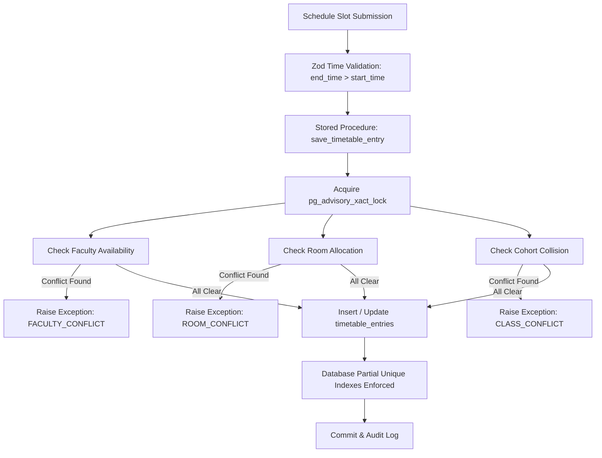

# Milestone 6: Universal Timetable & Scheduling Engine Documentation

## 1. Executive Summary

Milestone 6 implements the **Universal Timetable & Scheduling Engine** for the Multi-Institution Education Management Platform. It delivers a single configurable timetable and workload allocation engine supporting all institutional tiers:
- **K-12 Schools**: Standard weekly periods, morning assemblies, recess/lunch breaks, and section-level class schedules managed by class teachers.
- **Junior Colleges**: Morning and afternoon shift schedules across academic streams (MPC, BiPC, MEC, CEC) and second-year groups.
- **Degree Colleges, Engineering Colleges & Universities**: Modular lecture, lab, and practical session schedules across departments and academic programs, integrated with credit-hour requirements and physical room/lab facilities.

### Key Capabilities Built:
1. **Configurable Timetable Structures (`timetable_structures`, `timetable_periods`)**:
   - Institutions configure their own working days (e.g. Monday–Friday, or Monday–Saturday), working hours, period slots, breaks, lunch, and program-specific shifts without duplicating codebases.
2. **Weekly Recurring Scheduled Entries (`timetable_entries`)**:
   - Captures institution, campus, academic year, class, section (or combined lecture), subject, faculty, room, day of week, period number, start/end times, session type (`theory`, `practical`, `laboratory`, `tutorial`, `seminar`), and effective date ranges.
3. **Database-Enforced Conflict Prevention**:
   - **Faculty Double-Booking**: Guaranteed at database level via partial unique index `uq_faculty_schedule_slot`.
   - **Room Double-Booking**: Guaranteed at database level via partial unique index `uq_room_schedule_slot`.
   - **Cohort Collision**: Guaranteed at database level via partial unique index `uq_class_section_schedule_slot`.
   - **Timing Overlap Detection**: Stored procedure `check_timetable_entry_conflicts` checks arbitrary interval collisions using PostgreSQL `OVERLAPS`.
   - **Concurrency Safety**: Stored procedure `save_timetable_entry` acquires transaction-level advisory locks to eliminate race conditions during concurrent schedule modifications.
4. **Room and Lab Facility Management (`rooms`)**:
   - Classrooms, computer labs, science laboratories, seminar halls, and auditoriums with capacity limits, campus linkage, and tracked facility amenities (projector, smartboard, computers, AC).
5. **Conflict-Free Faculty Substitution (`timetable_substitutions`)**:
   - Enables replacement of absent faculty members for specific dates without silently modifying or corrupting the master weekly timetable.
   - Includes real-time substitute finder (`get_available_substitute_faculty`) identifying active teachers who have no scheduled classes, no existing substitution duties, and no approved leaves.
6. **Student & Faculty Timetable Access**:
   - Filterable weekly grid and daily schedule views with printable layouts (`@media print`) and workload distribution metrics.
7. **Attendance Engine Integration**:
   - Timetable serves as the authoritative source of academic sessions.
   - In accordance with architectural principles, future timetable entries do NOT automatically pollute attendance logs with phantom records.
   - Authorized teachers initiate attendance sessions directly from today's timetable slot (`startAttendanceFromTimetableAction`), linking `attendance_sessions.timetable_entry_id`.
8. **Role-Based Access Control & PostgreSQL RLS**:
   - Granular permissions (`timetable:manage`, `timetable:view`, `timetable:substitute`, `rooms:manage`, `rooms:view`) with tenant-scoped RLS policies on all 6 new tables.

---

## 2. Database Schema & Architecture Decisions

### 2.1 Schema Entity Relationship Summary

| Table Name | Primary Responsibility | Key Constraints & Integrity Rules |
| :--- | :--- | :--- |
| `rooms` | Campus classrooms, laboratories, and seminar halls | `institution_id NOT NULL`, `uq_institution_campus_room`, `chk_room_capacity` |
| `timetable_structures` | Institution shift/schedule templates | `institution_id NOT NULL`, `chk_structure_working_hours`, `chk_structure_periods_positive` |
| `timetable_periods` | Period and break definitions within a structure | Foreign key to `timetable_structures` ON DELETE CASCADE, `chk_period_times`, `uq_structure_period` |
| `timetable_entries` | Master weekly recurring schedule assignments | Partial unique indexes `uq_faculty_schedule_slot`, `uq_room_schedule_slot`, `uq_class_section_schedule_slot` |
| `timetable_substitutions` | Transient date-specific faculty replacement | `chk_substitute_not_original`, `uq_entry_substitution_date` (pending/approved) |
| `schedule_notifications` | Timetable change and substitution alerts | Tenant isolated, polymorphic recipient references |

### 2.2 Conflict Prevention Architecture



1. **Faculty Conflict Index**:
   ```sql
   CREATE UNIQUE INDEX uq_faculty_schedule_slot
   ON public.timetable_entries (institution_id, academic_year_id, faculty_id, day_of_week, period_number)
   WHERE is_active = true;
   ```
2. **Room Allocation Index**:
   ```sql
   CREATE UNIQUE INDEX uq_room_schedule_slot
   ON public.timetable_entries (institution_id, academic_year_id, room_id, day_of_week, period_number)
   WHERE is_active = true AND room_id IS NOT NULL;
   ```
3. **Cohort Schedule Index**:
   ```sql
   CREATE UNIQUE INDEX uq_class_section_schedule_slot
   ON public.timetable_entries (
     institution_id,
     academic_year_id,
     class_id,
     COALESCE(section_id, '00000000-0000-0000-0000-000000000000'::uuid),
     day_of_week,
     period_number
   )
   WHERE is_active = true;
   ```

---

## 3. Migration Files & Reversibility

### 3.1 Forward Migration
- **File**: `supabase/migrations/20261105050000_timetable_scheduling.sql`
- **Actions**:
  - Enums created: `room_type`, `timetable_session_type`, `day_of_week`, `timetable_break_type`, `session_slot`, `substitution_status`, `schedule_change_type`, `schedule_notification_recipient`.
  - Tables created: `rooms`, `timetable_structures`, `timetable_periods`, `timetable_entries`, `timetable_substitutions`, `schedule_notifications`.
  - Altered `attendance_sessions` to add `timetable_entry_id UUID REFERENCES timetable_entries(id)`.
  - Stored procedures: `check_timetable_entry_conflicts`, `get_available_substitute_faculty`, `save_timetable_entry`.
  - RLS Policies enabled on all tables for `SELECT`, `INSERT`, `UPDATE`, `DELETE`.

### 3.2 Rollback Script
- **File**: `supabase/migrations/rollback/20261105050000_rollback.sql`
- **Actions**:
  - Drops `timetable_entry_id` column from `attendance_sessions`.
  - Drops stored procedures and helper functions.
  - Drops all 6 tables in reverse foreign key order.
  - Drops all 8 custom enums cleanly.

---

## 4. Web Application Routes Implemented

| Route | View Component | Core Functionality |
| :--- | :--- | :--- |
| `/dashboard/timetable` | `TimetableOverviewClient` | Summary metrics, active shift templates, today's live scheduled slots, quick navigation |
| `/dashboard/timetable/manage` | `TimetableManageClient` | Structure selector, period config, weekly visual schedule grid, entry modal with instant conflict check |
| `/dashboard/timetable/classes` | `ClassTimetableClient` | Class & section schedule view, printable timetable (`@media print`), attendance initiation button |
| `/dashboard/timetable/faculty` | `FacultyTimetableClient` | Teacher workload breakdown, weekly schedule, substitution request dialog, conflict-free substitute finder |
| `/dashboard/timetable/rooms` | `RoomManagementClient` | Classroom and lab directory, facility amenity tags, room creation dialog, weekly occupancy schedule |

---

## 5. Security & RBAC Matrix

| Role | `timetable:manage` | `timetable:view` | `timetable:substitute` | `rooms:manage` | `rooms:view` |
| :--- | :---: | :---: | :---: | :---: | :---: |
| `owner` / `super_admin` | Yes | Yes | Yes | Yes | Yes |
| `admin` | Yes | Yes | Yes | Yes | Yes |
| `academic_admin` | Yes | Yes | Yes | Yes | Yes |
| `department_head` | Yes | Yes | Yes | No | Yes |
| `faculty` | No | Yes | Yes | No | Yes |
| `staff` | No | Yes | No | No | Yes |
| `student` | No | Yes | No | No | No |
| `parent` | No | Yes | No | No | No |
| `admissions_officer` | No | Yes | No | No | Yes |
| `hr_administrator` | No | Yes | No | No | No |
| `accountant` | No | Yes | No | No | No |

---

## 6. Verification & Quality Gates

- **Vitest Unit & Security Suite**:
  - `tests/unit/timetable-validators.test.ts`: 19 tests validating Zod schemas (room capacity, periods, working days, hex colors, substitution rules).
  - `tests/security/timetable-conflict.test.ts`: 6 tests verifying teacher conflict prevention, room double-booking prevention, cohort collision check, time overlap check, tenant isolation, and substitution availability.
  - `tests/unit/rbac.test.ts`: 12 tests verifying timetable & room permissions across all 11 roles.
  - Overall Suite: **143 passed across 13 test suites** (`npm test`).
- **Static Analysis & Typecheck**:
  - `npm run typecheck`: **0 errors across all 6 workspaces** (`@edu-platform/types`, `@edu-platform/validators`, `@edu-platform/database`, `@edu-platform/auth`, `@edu-platform/web`, `@edu-platform/mobile`).
- **Production Compilation**:
  - `next build`: **Compiled successfully** with static and server-rendered routes for all 5 timetable pages.
